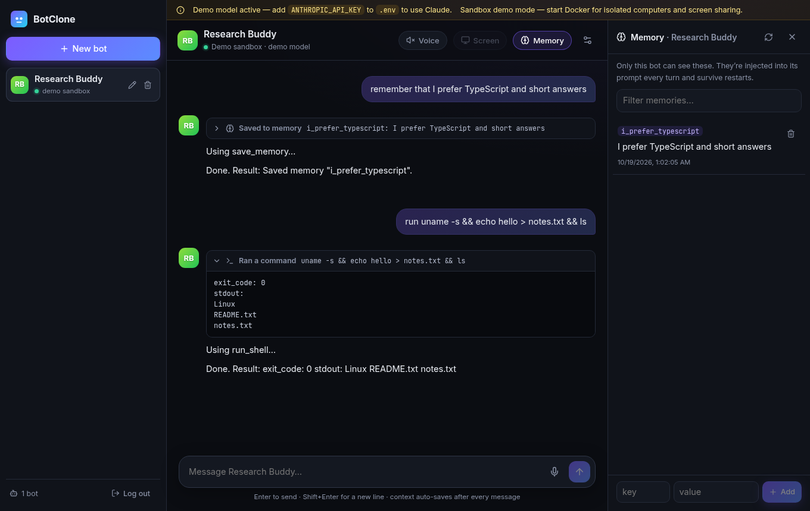
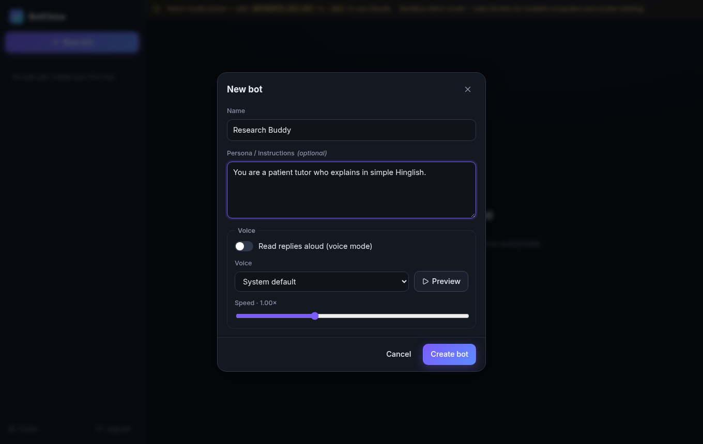
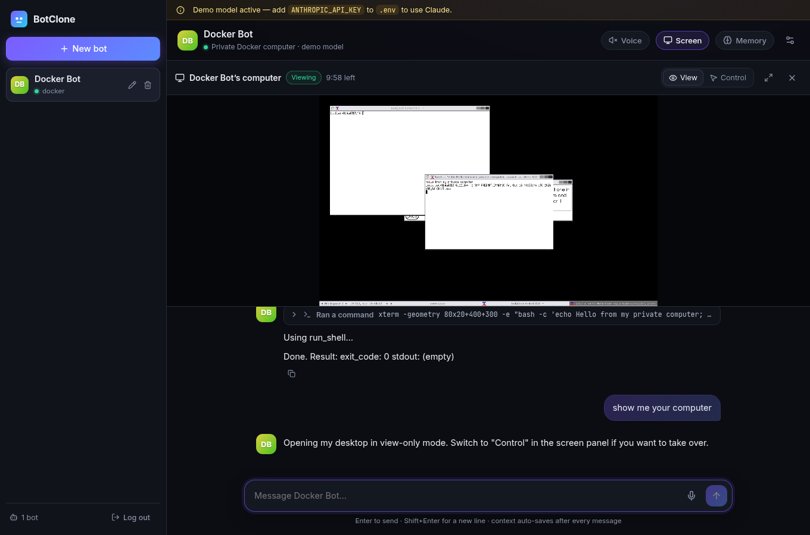
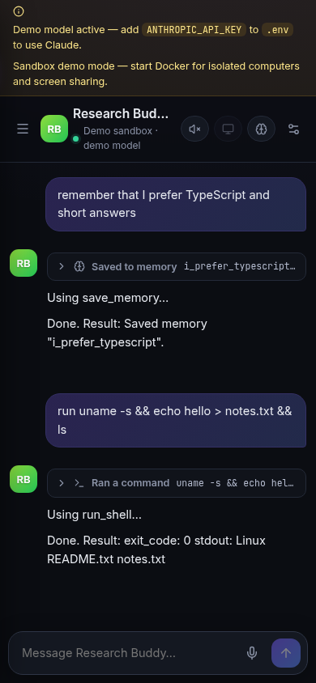

# BotClone

A self-hosted, multi-bot AI assistant platform. Every bot you create is a fully isolated unit with:

- **Its own conversation context**: never shared with other bots, auto-saved after every message, auto-summarised when it gets long.
- **Its own persistent memory**: the bot saves and recalls facts through Claude tool use (`save_memory`, `recall_memory`, `delete_memory`). Memories are stored per bot in SQLite and injected into its prompt every turn.
- **Its own computer**: a Docker container (Debian + virtual desktop) that only that bot can run commands in (`run_shell`). It has CPU, memory and PID limits, no host mounts and no published ports.
- **Screen sharing / remote control**: watch or control the bot's desktop in the browser (noVNC). Type "show me your computer" or "apna computer dikhao".
- **Voice**: talk to the bot (Web Speech API) and have replies read aloud, with a voice and speed set per bot.

The model is **Anthropic Claude**, called from the backend with your `ANTHROPIC_API_KEY`.



| New bot | Screen share | Mobile |
|---|---|---|
|  |  |  |

---

## Quick start (Mac, one command with Docker Desktop)

```bash
cp .env.example .env
#   edit .env: set ANTHROPIC_API_KEY=sk-ant-...   and   OWNER_PASSWORD=<something strong>
docker compose up --build
```

Open **http://localhost:8787** and sign in with `OWNER_PASSWORD`.

`docker compose` builds two images: `botclone-sandbox:latest` (the per-bot computer) and `botclone-app` (API + UI). The app uses the Docker socket to start one container per bot.

## Run natively (development)

Requirements: Node.js 20.11+ (22 LTS recommended), Docker Desktop (optional; without it you get demo mode).

```bash
npm install                 # installs server + web workspaces
npm run sandbox:build       # builds botclone-sandbox:latest (needs Docker)
cp .env.example .env        # add ANTHROPIC_API_KEY and OWNER_PASSWORD
npm start                   # builds web + server, serves everything on http://localhost:8787
```

To work with hot reload, run `npm run dev`. The API runs on :8787 and the Vite UI on **http://localhost:5173**, which proxies `/api` and `/vnc`.

> If you use npm 11.21 or later, it may ask you to approve install scripts. `package.json` already includes an `allowScripts` entry for `better-sqlite3` and `esbuild`. If npm still blocks them, run `npm install-scripts approve better-sqlite3 esbuild`.

## Where the API key goes

Put it in **`.env` in the repo root**:

```
ANTHROPIC_API_KEY=sk-ant-...
CLAUDE_MODEL=claude-sonnet-5-5
```

The key is only read by the backend and is never sent to the browser or into bot sandboxes. If no key is set, BotClone runs a **built-in demo model** so you can try the UI and the tools. A banner in the UI tells you when demo mode is on.

## Configuration

Everything is set through `.env`. See [`.env.example`](.env.example) for the full list. The most important settings:

| Variable | Default | Meaning |
|---|---|---|
| `ANTHROPIC_API_KEY` | (empty) | Claude API key. If empty, the demo model is used |
| `CLAUDE_MODEL` | `claude-sonnet-5-5` | Any Claude model id |
| `OWNER_PASSWORD` | random, printed in the logs | Login password for the web UI |
| `SESSION_SECRET` | random per run | Signs session cookies and screen tokens. Set it to keep sessions across restarts |
| `SANDBOX_MODE` | `auto` | `docker`, `subprocess` (demo) or `auto` (Docker if reachable) |
| `SANDBOX_NETWORK` | `egress` | `none`, `isolated` (no internet) or `egress` |
| `SANDBOX_MEMORY_MB` / `SANDBOX_CPUS` / `SANDBOX_PIDS_LIMIT` | 512 / 1 / 256 | Per-bot resource limits |
| `SANDBOX_IDLE_MINUTES` | 30 | Idle containers are stopped, then restarted lazily on next use |
| `CONTEXT_MAX_MESSAGES` / `CONTEXT_KEEP_MESSAGES` | 40 / 16 | When history is summarised, and how much stays verbatim |

## Using it

1. **New bot**: give it a name, an optional persona, and pick a voice (use Preview to hear it). The UI shows *pending → ready* while the container is provisioned. If provisioning fails, the bot is rolled back completely.
2. **Chat**: replies stream in. Tool calls (memory, shell) show up as expandable cards.
3. **Memory**: the Memory panel lists what this bot remembers. You can add or delete entries by hand.
4. **Screen**: the Screen button (or saying "show me your computer" / "screen dikhao") opens the bot's desktop. It starts view-only; switch to Control to use the mouse and keyboard. A session lasts 10 minutes, after which you click Reconnect.
5. **Voice**: the mic button transcribes as you speak and sends when you stop. The Voice toggle in the header reads replies aloud. Voice works in Chrome, Edge and Safari. Firefox has no speech recognition, so the mic is disabled there with an explanation.
6. **Rename / delete**: hover a bot in the sidebar. Deleting a bot removes its container, volume, history and memories.

## Architecture

See **[docs/ARCHITECTURE.md](docs/ARCHITECTURE.md)** for diagrams and details. In short:

```
web/  React + Vite + TS  ──REST/SSE──►  server/  Express + TS
                         ──WebSocket─►    routes → services → repositories (SQLite)
                                          orchestrator ──Docker API──► one container per bot
                                          llm ──► Anthropic Claude
```

## Project layout

```
botclone/
├── docker-compose.yml        # one-command run (app + sandbox image)
├── Dockerfile                # app image (API + built UI)
├── .env.example
├── sandbox/                  # per-bot computer image (Xvfb, fluxbox, x11vnc, socat, python, git…)
├── docs/                     # ARCHITECTURE.md, DEPLOY.md, screenshots
├── server/
│   ├── src/
│   │   ├── index.ts          # composition root
│   │   ├── app.ts            # express app + VNC WebSocket
│   │   ├── config.ts         # zod-validated env
│   │   ├── db.ts             # SQLite + migrations
│   │   ├── routes/           # auth, bots (lifecycle, chat SSE, memory, sandbox, screen), vncProxy
│   │   ├── services/         # bot, chat (agent loop), context, memory, screen, auth, intent
│   │   ├── repositories/     # bots, messages/summaries, memories
│   │   ├── orchestrator/     # Orchestrator, DockerProvider, SubprocessProvider (demo)
│   │   ├── llm/              # Claude client + deterministic mock
│   │   └── lib/              # logger (pino), errors, tokens (HS256)
│   └── test/                 # node:test suites
└── web/
    └── src/
        ├── App.tsx
        ├── components/       # Sidebar, ChatView, MessageList, NewBotModal, BotSettingsModal,
        │                     # MemoryPanel, ScreenPanel, VoiceControls, VoicePicker, LoginScreen
        ├── hooks/useVoice.ts # Web Speech STT + speechSynthesis TTS
        └── lib/              # api client (fetch + SSE), types, turn rendering
```

## Tests

```bash
npm test          # 28 tests: isolation, memory, context/summarisation, orchestrator, auth/intent, HTTP API
npm run typecheck
```

The orchestrator tests run against an in-memory fake of the Docker API. They cover the container spec, limits, no mounts or ports, network policy, rollback, reconcile, lazy restart and the idle reaper. The real-Docker checks we ran are listed in `docs/ARCHITECTURE.md` under "Verification".

## Security notes

- Only the owner has access: a password login sets an httpOnly signed cookie. The VNC socket needs that cookie **and** a 10-minute token tied to one bot and one mode. View-only mode is enforced by a separate `x11vnc -viewonly` server.
- Bot containers run as a non-root user with `CapDrop: ALL`, `no-new-privileges`, CPU, memory and PID limits, no host mounts, no published ports, and no traffic between containers.
- The **app** container mounts `/var/run/docker.sock`, which gives root-level control of the host. Only deploy it on a machine or VM you dedicate to BotClone.
- **Demo mode (subprocess) is not a security boundary.** Use it only for demos.

## Deploying

See **[docs/DEPLOY.md](docs/DEPLOY.md)**. It covers a VPS with Docker for the full product, and Railway, Render or Fly.io in demo mode.
