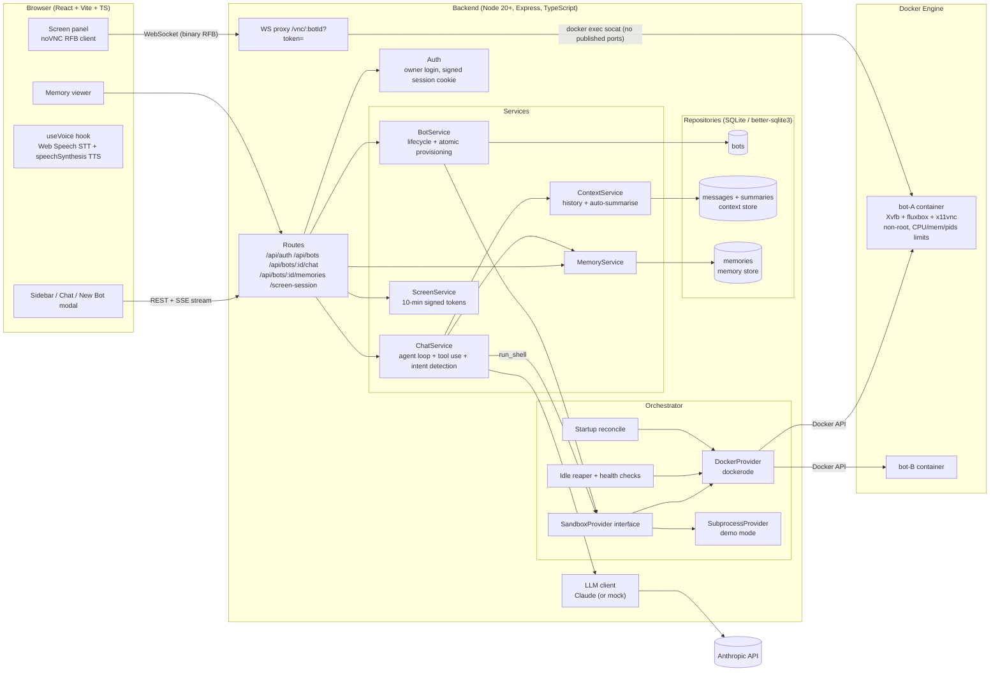
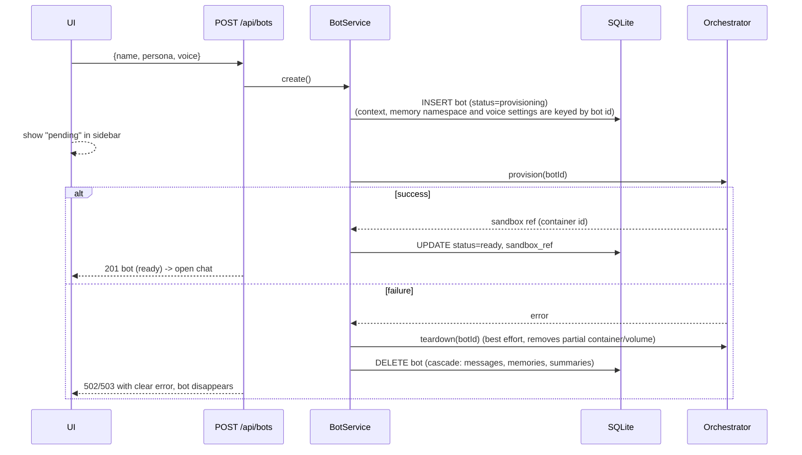
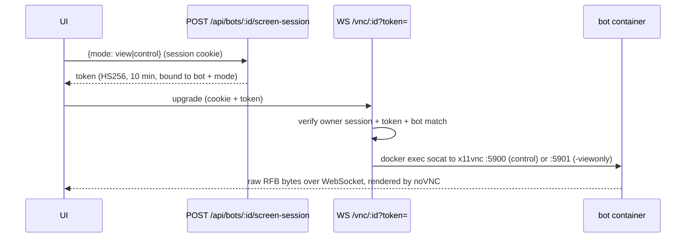

# BotClone — Architecture

BotClone is a multi-bot AI assistant platform. Every bot is a fully isolated unit:
its **own conversation context**, its **own persistent memory**, its **own voice settings**
and its **own sandboxed computer** (a Docker container with a virtual desktop).
The language model is Anthropic Claude (default `claude-sonnet-5-5`, configurable via `CLAUDE_MODEL`), called from the backend with `ANTHROPIC_API_KEY`.

## 1. High-level diagram

## 2. Layers

| Layer | Location | Responsibility |
|---|---|---|
| Frontend | `web/` | React 18 + Vite + TypeScript SPA. Dark, responsive UI: bot sidebar, streaming chat, New Bot modal (name, persona, voice picker + preview, provisioning status), rename/delete, memory viewer, voice mode, screen panel (noVNC). |
| Routes | `server/src/routes/` | HTTP surface only: auth guard, zod validation, map to services, SSE streaming. |
| Services | `server/src/services/` | Business logic: bot lifecycle, chat agent loop, context & summarisation, memory, screen sessions, intent detection. |
| Repositories | `server/src/repositories/` | All SQL lives here. Every query that touches bot data is keyed by `bot_id`. |
| Orchestrator | `server/src/orchestrator/` | Sandbox provisioning/teardown, exec, resource limits, health, idle reaping, reconcile, VNC tunnel. |
| LLM | `server/src/llm/` | Claude client (streaming, tool use) + deterministic mock for tests/demo without a key. |

## 3. Bot lifecycle

* **Rename / persona / voice**: `PATCH /api/bots/:id`.
* **Delete**: `DELETE /api/bots/:id` → container + volume removed → DB rows cascade-deleted.
* **Startup reconcile**: bots stuck in `provisioning` (crash mid-create) are rolled back;
  containers labelled `botclone.managed=true` whose bot no longer exists are removed;
  bots whose container vanished are re-provisioned lazily on next use.

## 4. Context store (per-bot isolation)

* Table `messages(bot_id, role, content_json, summarized)` stores raw Anthropic content blocks
  (text, `tool_use`, `tool_result`, and opaque `thinking` / `redacted_thinking` blocks that newer
  models emit and that must be replayed verbatim next to their `tool_use`), so a conversation replays exactly.
* Every read/write passes the `bot_id` from the URL; the model never chooses which bot's data it touches.
* **Auto-save**: the user turn is persisted before the model is called; each assistant
  step and tool result is persisted as soon as it completes. A crash mid-turn loses nothing already produced.
* **Summarisation**: when a bot has more than `CONTEXT_MAX_MESSAGES` unsummarised messages,
  the oldest part (cut at a clean user-text boundary so tool_use/tool_result pairs are never split)
  is summarised by Claude into `summaries(bot_id)` and flagged `summarized=1`. The summary is
  injected into the system prompt; the UI still shows the full history.
* Per-bot turn lock: one turn at a time per bot, so histories never interleave.

## 5. Memory store

* Table `memories(bot_id, key, value)`, unique per `(bot_id, key)`.
* Tools exposed to Claude: `save_memory(key, value)`, `recall_memory(query?)`, `delete_memory(key)`.
* All memories of the bot (up to `MEMORY_INJECT_LIMIT`) are injected into the system prompt every turn.
* Survives restarts (SQLite file in `DATA_DIR`). Viewable/deletable in the UI memory panel.

## 6. Orchestrator (sandbox per bot)

`SandboxProvider` interface: `provision`, `ensureRunning`, `exec`, `teardown`, `status`,
`listManaged`, `openVncStream`.

### DockerProvider (default when Docker is reachable)
* One container per bot: `botclone-bot-<botId>`, image `botclone-sandbox:latest` (`sandbox/Dockerfile`).
* **Limits**: `SANDBOX_MEMORY_MB` (512), `SANDBOX_CPUS` (1.0), `PidsLimit` 256,
  `CapDrop: ALL`, `no-new-privileges`, non-root user `bot`.
* **No host mounts.** Only a Docker-managed named volume `botclone-vol-<botId>` for the bot's home.
* **Network policy** `SANDBOX_NETWORK`: `none` (no network at all), `isolated` (internal bridge,
  no internet), `egress` (bridge with internet, default).
* **No published ports.** Shell commands run via `docker exec`; the desktop is reached by
  `docker exec socat - TCP:127.0.0.1:5900` tunnelled through the Docker API, so screen sharing works
  under every network policy and no VNC port is ever exposed on the host.
* **Health**: image HEALTHCHECK (`pgrep Xvfb`), `status()` inspects state + health.
* **Idle reaper**: containers idle longer than `SANDBOX_IDLE_MINUTES` are stopped; next use
  restarts them lazily (`ensureRunning`). Files persist in the volume.

### SubprocessProvider (demo mode)
* Used when `SANDBOX_MODE=subprocess`, or `auto` and Docker is unreachable (e.g. a PaaS without DinD).
* Each bot gets `DATA_DIR/sandboxes/<botId>`; commands run with that cwd, a scrubbed env,
  `ulimit` CPU/memory/file-size caps and a timeout. **Not a security boundary** — demo use only.
* No desktop/screen sharing in this mode (API returns a clear 501).

## 7. Screen sharing / remote control

* View-only is enforced **server-side**: view tokens connect to an `x11vnc -viewonly` instance.
* When the token expires the socket is closed and the UI asks to re-open (re-auth if the session expired).
* **Intent detection**: chat messages like "show me your computer", "apna computer dikhao",
  "screen dikhao" are matched before the LLM call; the backend issues a session and emits a
  `screen` SSE event, and the UI opens the panel automatically.

## 8. Voice

* `useVoice` hook (frontend only): Web Speech API `SpeechRecognition` for speech-to-text with interim
  transcript and auto-send when the user stops speaking; `speechSynthesis` reads each completed bot reply aloud.
* `VoiceControls` component: mic button, live transcript, voice-mode toggle in the chat header.
* Per-bot settings `voice_enabled`, `voice_name`, `voice_rate` are stored on the bot row (`PATCH /api/bots/:id`).
* Graceful fallback: if the browser lacks `SpeechRecognition` (e.g. Firefox), the mic is disabled
  with an explanation; TTS still works where `speechSynthesis` exists. Chrome and Safari support both.

## 9. Auth

* Single-owner product model: `OWNER_PASSWORD` in `.env`. `POST /api/auth/login` sets an
  HMAC-signed, httpOnly, SameSite=Lax session cookie (`SESSION_TTL_HOURS`).
* All `/api/*` routes (except login/health) and the VNC WebSocket require the session.

## 10. Request flow for one chat turn

1. `POST /api/bots/:id/chat` (SSE). Acquire per-bot lock. Persist user message.
2. Intent check (screen request) → maybe short-circuit with a `screen` event.
3. Build system prompt = persona + summary + memories + tool guidance.
4. Stream Claude; forward `text` deltas as SSE. Persist assistant message.
5. If `tool_use`: execute tools bound to this bot (memory / `run_shell` in this bot's sandbox),
   emit `tool` events, persist `tool_result`, loop (max `AGENT_MAX_STEPS`).
6. Maybe summarise old history. Emit `done`. Release lock.

## 11. Deployment shapes

* **Mac / VPS with Docker**: `docker compose up --build` — app container talks to the host Docker
  daemon via `/var/run/docker.sock` (sibling containers, not nested). Full features.
* **PaaS without Docker (Railway/Render/Fly app)**: run the app image with `SANDBOX_MODE=subprocess`
  for a live demo (no desktop). See `docs/DEPLOY.md`.

## 12. Design decisions

| Decision | Why |
|---|---|
| **VNC over `docker exec socat`** instead of a websockify port in each container | No container ever publishes a port, it works under `SANDBOX_NETWORK=none`, and it works the same whether the server runs on the Mac host or inside compose (Docker Desktop cannot route to container IPs from macOS). The server terminates the browser WebSocket with `ws` and pipes raw RFB bytes, which is what websockify would do. |
| **Two x11vnc servers (5900 control, 5901 `-viewonly`)** | View-only is enforced server-side, so a view token cannot inject input. |
| **SQLite (better-sqlite3, WAL)** | Zero-ops, a single file, synchronous transactions make atomic create/rollback simple. All access is keyed by `bot_id` in repositories. Swap the repositories for Postgres when you go multi-tenant. |
| **SSE for chat, WebSocket only for VNC** | SSE works through every proxy and PaaS and maps naturally to token streaming. |
| **Bot id comes from the URL, never from the model** | Tools are bound server-side to the route's bot, so a prompt-injected model cannot reach another bot's memory or sandbox. |
| **Mock LLM** | The product, its tests and demos run without a key. The mock follows the same tool-use protocol as Claude. |
| **Single-owner auth** | This matches the "personal bot fleet" product. Moving to multi-user means adding a `user_id` column to `bots` and scoping repositories by it. |

## 13. Verification (what was actually exercised)

Automated (`npm test`, 28 tests, mock LLM, fake Docker API): context isolation, memory namespacing and prompt injection, persistence across DB reopen, auto-save on model failure, summarisation boundary, thinking-block replay, container spec (limits, no mounts or ports, hardening), network policies, atomic rollback, Docker-down errors, auto fallback to demo, reconcile, lazy restart, idle reaper, auth tokens, screen-intent detection, and the HTTP API including VNC auth rejection.

Manual end-to-end on a Linux host with a real Docker daemon:
- Bot create provisions a hardened container in about 0.3 s. `docker inspect` showed 512 MB, 1 CPU, pids 256, CapDrop ALL, no-new-privileges, no binds, no ports, a named volume only, user `bot`, and a healthy status.
- `run_shell` ran inside only that bot's container. Files persisted across idle-stop and lazy restart.
- The idle reaper stopped the container, and the next message restarted it.
- Startup reconcile removed an orphan container and its volume. Bot delete removed the container and volume.
- A real provisioning failure (missing image) returned a 503 with an actionable message and left no DB row, container or volume.
- With `SANDBOX_NETWORK=isolated`, the network was internal with ICC off and had no internet.
- VNC: both control and view tokens returned an `RFB 003.008` greeting through the tunnel, and a token for another bot got a 403. In headless Chrome the noVNC panel rendered the live desktop and switched between view and control.
- `docker compose up --build` brought up the app and sandbox image. Create, exec, VNC and delete all worked from inside compose.
- The app image ran in demo mode (no Docker) as a non-root user with a scrubbed environment.
- Real Anthropic endpoint: reached with an invalid key, and the 401 was mapped to a friendly error. **A successful Claude conversation was not run, because no key was available during development.**
- UI (headless Chrome): login, create bot, streaming chat, tool cards, memory panel, isolation between two bots, rename, voice toggle persisted per bot, delete, mobile layout.

Not verified: real speech recognition and TTS output (needs a microphone and speakers in a real browser), Safari, Docker Desktop on macOS specifically (the Linux engine was used), and nested Docker on PaaS.
